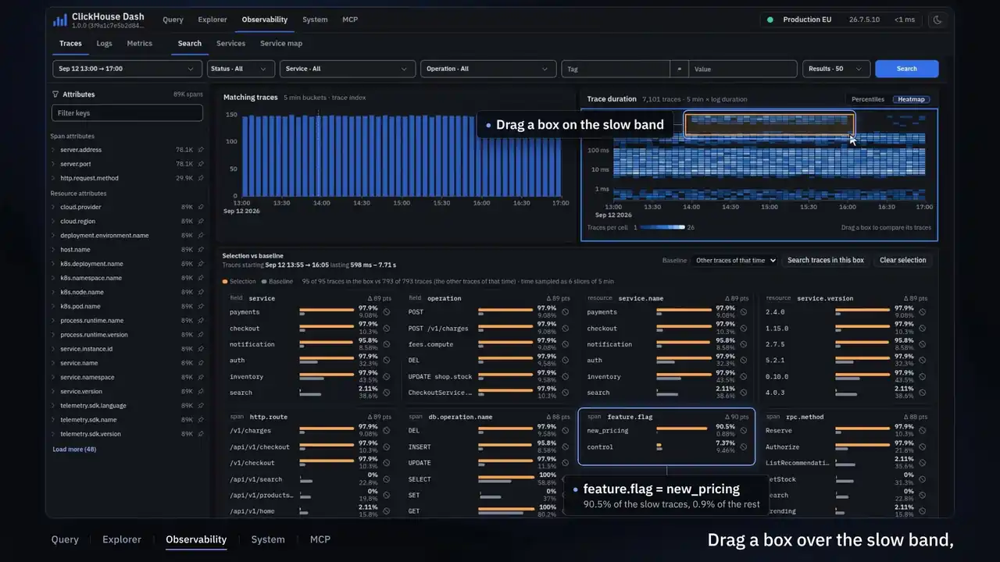
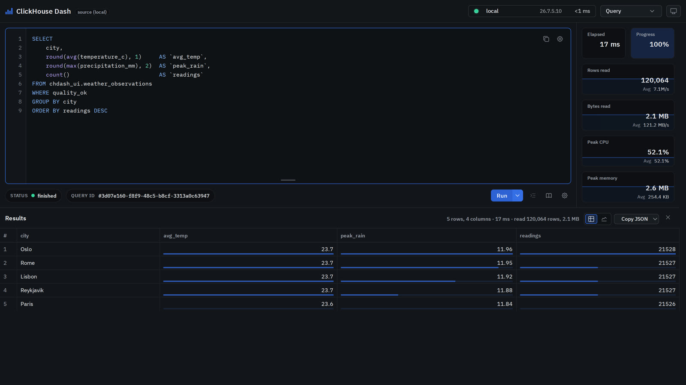
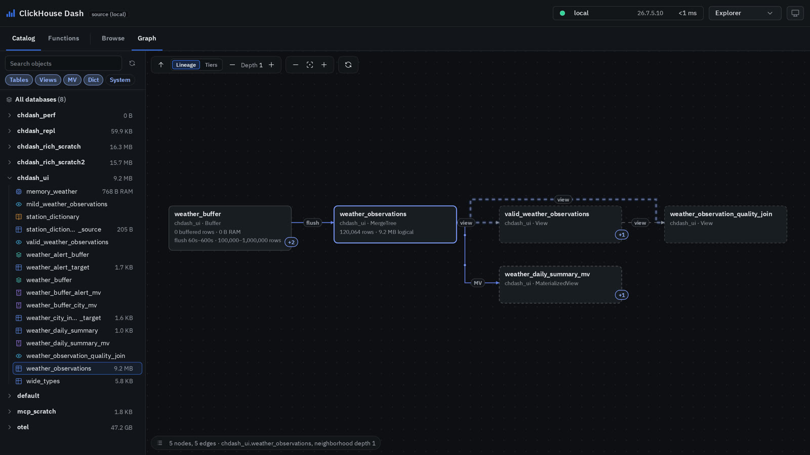
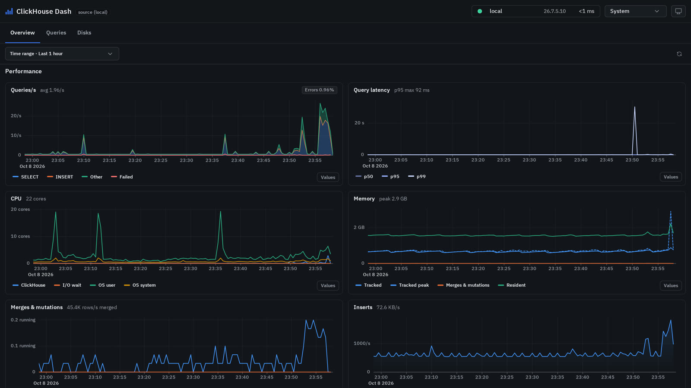
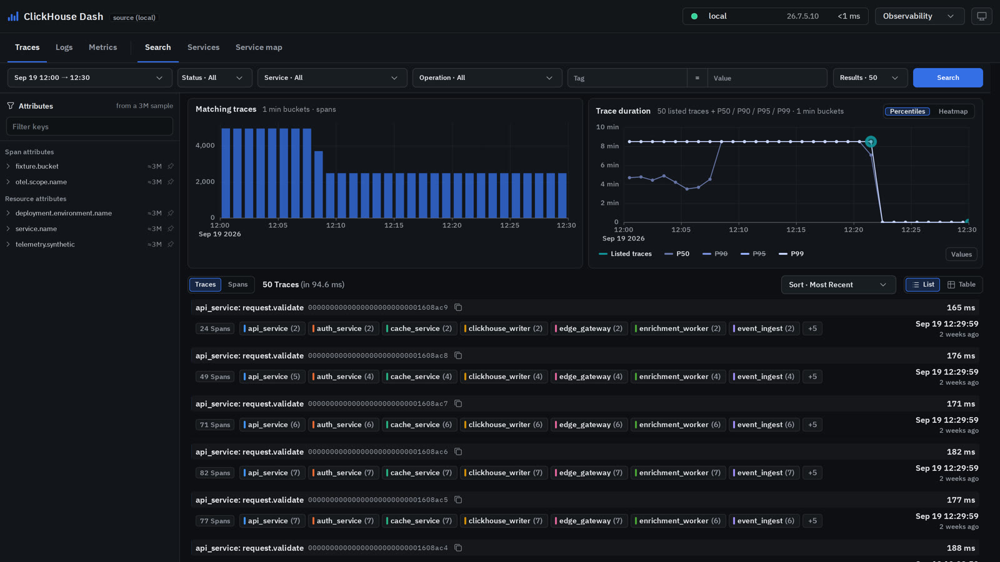
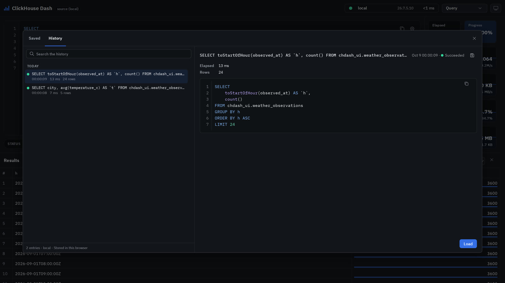
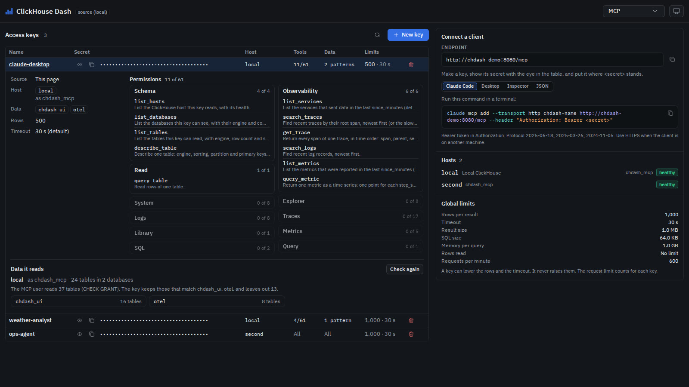

# clickhouse-dash

A lightweight real-time ClickHouse query dashboard.

**[Home page](https://circular-fi.github.io/Clickhouse-dash/)** · **[Documentation](https://circular-fi.github.io/Clickhouse-dash/documentation.html)** · **[Download v1.0.6](https://github.com/Circular-fi/Clickhouse-dash/releases/latest)**

<p align="center">
  <video src="docs/media/chdash-presentation-1080.mp4" poster="docs/assets/img/poster-1280.webp" width="100%" controls playsinline preload="none">
    <a href="docs/media/chdash-presentation.mp4"></a>
  </video>
</p>

The video presents ClickHouse Dash with sample data, a voice-over and music. It lasts 74 seconds. If your viewer does not play the video, [open the video](docs/media/chdash-presentation.mp4). The original encode is 14 MB. The player above plays a lighter full HD copy.

The music is "Happy Beats & Business Moves Vol. 12" by Sascha Ende ([ende.app](https://ende.app)). The license is [CC BY 4.0](https://creativecommons.org/licenses/by/4.0/). Use the sources in [docs/media/source](docs/media/source/README.md) to record and render the video again.

| Query | Explorer |
| --- | --- |
| [](docs/media/screen-query.jpg) | [](docs/media/screen-explorer.jpg) |
| **System** | **Traces** |
| [](docs/media/screen-system.jpg) | [](docs/media/screen-traces.jpg) |
| **History and saved queries** | **MCP** |
| [](docs/media/screen-history.jpg) | [](docs/media/screen-mcp.jpg) |


- Backend: **C++17** with clickhouse-cpp, cpp-httplib and RapidJSON
- Frontend: **vanilla JavaScript and Canvas**
- Query transport: **ClickHouse native TCP**
- Browser transport: **Server-Sent Events**

## Features

- Run ClickHouse SQL with streamed result batches.
- Right-click a result row. Select **Details** to expand that row in place. This works in Query results, in multiquery panels and in the Explorer data preview. The results must have at least two rows.
- A detail row opens directly below the row. It shows the name, the type and the full, pretty-printed value of every column, like a result with one row. The detail row has the width of the visible table. It also works with virtualized results. These actions collapse the detail row: a click elsewhere, Escape, the close button and a new query. Shift+right-click keeps the context menu of the browser.
- The explicit **Run with profiling** mode enables the processor logs and the query-view logs for only that execution. A normal Run keeps the existing lightweight path.
- The on-demand **Analyze** feature reads the persisted ClickHouse execution logs. It finds the logs by the `query_id` of the panel. It does not replay the query.
- Original compact telemetry: elapsed time, read progress, read rates, CPU usage, and current and peak query memory.
- The native profile events of the ClickHouse query group give the CPU and memory values. The dashboard does not show inferred thread counts.
- Safe JSON serialization for native types and for non-finite floating-point values.
- Configuration of several hosts, health checks, query cancellation, SQL formatting, history, saved queries, syntax highlighting, autocomplete and reference diagnostics.
- Lazy column metadata with the scope of a table. This keeps the idle browser heap small.
- **System** page (`/system`) for the selected server. It has these parts:
  - An Overview. It has server tiles, a databases treemap, the topology, Keeper and replication. It also has ten performance charts from the system logs. It also has the queues of merges, mutations, replication and Distributed.
  - The top query shapes of `system.query_log`.
  - The disks with their growth and the time until they are full.

  The page uses fixed, read-only and bounded reads of system tables. The `system` block configures it.
- A built-in **MCP** server (`POST /mcp`, optional). AI clients read ClickHouse data with access keys. Each key has its own hosts, tools and data. MCP has its own read-only ClickHouse user. Every query runs with `readonly=1` and has caps on rows, bytes and time. The **MCP integration** page (`/mcp-integration`) manages the keys. Refer to [`docs/mcp.md`](docs/mcp.md).
- Bounded caches for results, history, metadata, SSE and sessions.
- WebAssembly kernels for the heavy front-end work: the SQL highlighter and scanner, the Explorer graph router, the layered layout, result sorting and chart preparation. Each kernel has a JavaScript fallback. Refer to [`docs/wasm.md`](docs/wasm.md).
- One self-contained binary with embedded frontend assets.
- Reproducible tests and benchmarks that compare the source with the release, with a direct ClickHouse HTTP floor.

## Architecture

```text
Browser
  POST /api/query/run
  GET  /api/query/stream?query_id=...  (SSE)
  POST /api/query/cancel
       |
       v
cpp-httplib server
       |
       v
ClickHouse native TCP via clickhouse-cpp
```

## Telemetry

Telemetry uses the original compact positional tick contract for compatibility. The thread metric no longer exists. ClickHouse does not give a deterministic count of the active threads of a query while the query runs. Read progress, rows, bytes, CPU and memory are still available.

The tests compare the deterministic SSE control events strictly. The counts of `result_rows` and `tick` are operational. They can change with the result batching, the query duration or the scheduling. They do not change the query semantics.

Refer to [`docs/telemetry.md`](docs/telemetry.md) for the complete event contract, the field definitions and the compatibility policy.

## Quick start with Docker tests and benchmarks

The host needs only Docker Compose. The test images contain Python, Node.js and Playwright.

Run these commands to start the local development stack. It has the current ClickHouse and a freshly built source dashboard:

```bash
cd tests
docker compose up -d
```

Run this command for the full automated analysis:

```bash
docker compose --profile test up -d --build
```

The default stack rebuilds the source dashboard. It starts the dashboard on port 18080 against the current ClickHouse. The `test` profile adds exactly one one-shot test container. That container runs four explicit categories: backend functional, frontend functional, performance and design. The container creates one archive and then exits. The archive path is:

```text
tests/artifacts/chdash-test-review.zip
```

The host does not need Python, Node.js, a Playwright browser, a test web UI, a release comparator or a historical ClickHouse service.

## Local build

Requirements: CMake 3.20 or newer, a C++17 compiler and Ninja.

```bash
cmake -S src -B build -G Ninja -DCMAKE_BUILD_TYPE=Release
cmake --build build --target chdash
./build/chdash --config /path/to/config.hcl
```

The default build embeds the frontend assets into the binary.

## Trace Explorer ClickHouse indexes

Use ClickHouse 26.1 or later for large OpenTelemetry trace tables. Keep the standard OTel table definitions. Add the two lightweight projection indexes that Trace Explorer uses:

```sql
ALTER TABLE otel.otel_traces
    ADD PROJECTION IF NOT EXISTS prj_traceid INDEX TraceId TYPE basic;

ALTER TABLE otel.otel_traces_trace_id_ts
    ADD PROJECTION IF NOT EXISTS prj_start INDEX Start TYPE basic;
```

If those tables already contain historical data, materialize the projections once:

```sql
ALTER TABLE otel.otel_traces
    MATERIALIZE PROJECTION prj_traceid;

ALTER TABLE otel.otel_traces_trace_id_ts
    MATERIALIZE PROJECTION prj_start;
```

The materialization is asynchronous by default. Use `SETTINGS mutations_sync=1` when the command must wait. For very large historical tables, materialize the projections partition by partition. Refer to [`docs/traces.md`](docs/traces.md) for the Trace Explorer schema, the access control, the search path and the projection details.

Trace search results and graph analytics use separate routes. Trace analytics are off by default. Set `traces.analytics = true` to enable the graph queries for the traces that match the search and for the duration percentiles. This does not affect the trace search.

The service and operation prefill refreshes automatically each time the selected time range changes. The tag filter is direct and exact. Enter an exact tag key and an exact value. The dashboard does not run tag discovery or LIKE/ILIKE matching.

## Massive downloads

The Run menu can stream complete CSV or JSON exports directly from ClickHouse into a ZIP64 download. The backend does not spool result datasets to disk. It does not keep them in RAM. A per-block serializer buffer bounds the exports. The exports use short-lived one-time download capabilities. Refer to [`docs/massive-export.md`](docs/massive-export.md).

## Configuration

The preferred mode uses one complete HCL file:

```bash
chdash --config /etc/clickhouse-dash/config.hcl
chdash --config /etc/clickhouse-dash/config.hcl --health
```

The application configuration is HCL-only. `--config` is required for the server mode and for the health mode. The application does not read environment variables. Refer to [`config.example.hcl`](config.example.hcl) for the complete schema. Refer to [`docs/configuration.md`](docs/configuration.md) for the behavior of the configuration, which comes from the source.

ChDash has no login page. The required `access` block selects the access of humans ([`docs/access.md`](docs/access.md)). With `mode = "authzen"`, an access gateway gives a signed identity token. ChDash verifies this token on each request. An AuthZEN PDP decides each action, for example `query.run.write` or `system.read`. With `mode = "open"`, ChDash checks nothing.

In both modes, each human uses the same ClickHouse authorization context for a configured host: `runner_uri`. A run without `query.run.write` uses `readonly = 1`. The backend keeps a bounded query registry by public `query_id` and host. In this way, Analyze, Execution and Deep Analyze can find completed runs after the backend removes their SSE session. The backend uses internal signed capabilities only for actions such as cancellation and one-time export downloads. They are not user identities.

The critical privilege boundary is the connection role. The backend runs the SQL from the panel with `runner_uri` only. The backend uses `system_uri` only for technical queries that it generates, such as reads of system logs and metadata, and `KILL QUERY`. The backend never replays or runs user SQL through `system_uri`.

`runner_uri` defines the query visibility. The backend uses it for these items:

- The health check of the host.
- The autocomplete of databases, tables and columns.
- Formatting.
- User queries.

The backend uses `system_uri` for these items:

- The server-wide catalogs.
- Diagnostics.
- Final statistics.
- Query cancellation.

For this reason, a failure of the system account does not mark a host as down when the host can still run queries.

## HTTP API

- `GET /livez`: liveness (the process answers). `GET /readyz`: readiness (a host answers and the server does not stop). `GET /healthz`: strict health (every host answers). `GET /metrics`: the Prometheus text format. Refer to [`docs/operations.md`](docs/operations.md) for the probes, the shutdown on SIGTERM, the JSON log and the metrics. The same document covers the HTTP security: the headers and the write guard.
- `GET /api/meta?host_id=<id>` build metadata and optional scoped autocomplete catalogs. A request without `host_id` gets `400 missing_host_id`. The other routes of the pages behave the same way.
  The server-wide catalogs use `system_uri`. They are `keywords`, `functions`, `table_functions`, `formats`, `settings` and `data_types`.
  The catalogs that depend on visibility use `runner_uri`. They are `databases`, `tables` and `columns`.
  A request for both kinds returns HTTP 200 with `partial=true` when at least one requested catalog succeeds.
  The keywords have a deterministic built-in fallback. It applies to old system accounts and to system accounts that are temporarily unreachable.
- `GET /api/hosts` host health snapshot.
- `GET /api/hosts/stream` host health SSE stream.
- `POST /api/format`: SQL formatting.
  - Send `{"host_id", "sqls": [...]}` to format a batch. The answer is `{"results": [...]}`. It has one entry for each statement, in order:
    - `{"index", "status": "formatted", "formatted_sql"}`. A `warning` appears when formatting can change what ClickHouse reads from the statement. The text then stays as it was written. See [`docs/formatter.md`](docs/formatter.md).
    - `{"index", "status": "error" | "skipped", "error": {...}}`.
  - A statement that fails does not fail the others. A statement is `skipped` when it starts more than 10 seconds after the start of the batch. A statement is also `skipped` when the caller disconnects.
  - The batch holds a ClickHouse connection only while a statement needs it.
  - To format one statement, send `{"host_id", "sql"}`. The answer is `{"formatted_sql"}`, with the same `warning`. Otherwise, the answer is an HTTP error.
  - The error from ClickHouse gives the location (`position`, `line`, `col`) in the text that the caller sent.
  - The backend reconnects stale pooled native connections and retries once. This adds no round trip on the healthy path.
  - For one statement, a persistent transport failure returns HTTP 502 with `error_code=clickhouse_transport_error`. A timeout returns HTTP 504 `format_timeout`. A host that is down returns HTTP 503 `format_unavailable`. SQL formatting errors return HTTP 422.
  - In a batch, the same codes appear in the `error` of the statement. Every error has the one JSON shape of [`docs/operations.md`](docs/operations.md#errors).
- `POST /api/query/run`: start a query. The response gives the stream URL and the cancel token.
  - `mode=normal` is the default.
  - `mode=profiling` applies the profiling settings only to that native Query object. It needs no application authentication.
  - Each run has a bounded query-registry record for the host.
  - Compatibility retries keep the public id stable. They use unique native ClickHouse attempt ids.
  - The backend stops a failed native attempt synchronously before it retries. In this way, ClickHouse never sees two attempts that run with the same id.
- `GET /api/query/stream?query_id=...` query results and telemetry SSE stream.
- `POST /api/query/cancel` cancel a query with its signed token.
- `POST /api/query/analysis` inspect a registered, completed query. The backend reads the data from `system.query_log`, the optional processor profiles, the query-view logs and the distributed child records that are locally visible. It does not replay the query.
- `GET /api/query/execution?host_id=...&query_id=...` retrieve the lightweight registered execution record that the post-run downloads use.
- `POST /api/query/deep-analysis`: start a job. The job runs the stored original SELECT-family SQL again with ClickHouse 26.7 `EXPLAIN ANALYZE`. The response code is `202`. Poll the job with `GET /api/query/deep-analysis?host_id=&job_id=`. Stop the job with `POST /api/query/deep-analysis/cancel`. The backend refuses mutating statements before it runs them. [`docs/query-analysis.md`](docs/query-analysis.md#deep-analyze-backend) describes the job.
- `GET /api/explorer/catalog?host_id=...` ACL-filtered Explorer List catalog. A manual `refresh=1` invalidates both the metadata caches and the authorization caches.
- `GET /api/explorer/table?host_id=...&database=...&table=...` table detail. It shows these items:
  - columns and compression weight
  - storage policy and local storage
  - parts and partitions
  - ingestion
  - replication
  - Distributed queue and topology where the backend can resolve them
  - dependencies
  - indexes and projections
  - merges and mutations
  - DDL
- `POST /api/explorer/table/data` preview up to 500 rows. It uses only the columns that the runner can read. It never sends an implicit `count()`.
- `GET /api/explorer/functions?host_id=...` function browser with the scope of the runner. It prefers ClickHouse 26.7 `system.documentation`. If the documentation for the version is unavailable, it uses the metadata of the server functions and gives no error.
- `GET /api/explorer/graph?host_id=...` ACL-filtered normalized logical and physical topology. The optional `database=...` limits the scope of the serialization.
- `GET /api/explorer/activity?host_id=...` short-lived live activity overlay for the graph. It does not rebuild the topology metadata.
- `GET /api/system/overview?host_id=...` the Overview of the System page. It has the server
  tiles, the `system.clusters` topology and the replication summary of the
  tables that the runner can see. It uses fixed, read-only, bounded reads of system tables.
  `/api/system/series`, `/api/system/disks`, `/api/system/queries`,
  `/api/system/activity` and `/api/system/keeper` serve the rest of the page
  (the `system` block). `GET /api/system/queries/<hash>` answers with the `normalized` text of a shape. It also answers with the same text formatted
  (`normalized_formatted`, `null` when it cannot be: [`docs/system.md`](docs/system.md#the-formatted-text-of-a-shape)). The routes `/api/explorer/ops/activity` and
  `/api/explorer/ops/keeper` of v2.14.0 stay as aliases.
- `POST /mcp` the MCP endpoint (only when `mcp.enabled`). It needs `Authorization: Bearer <key>`. `/api/mcp/meta` and `/api/mcp/keys` serve the MCP page. Refer to [`docs/mcp.md`](docs/mcp.md).
- `POST /api/export/run` prepare a direct-download request and issue a short-lived one-time export token.
- `POST /api/export/stream` with `{"token": ...}` in the JSON body: stream a ZIP64 archive directly from ClickHouse with bounded memory. No temporary file has the size of the result. The token is never in an address, and `GET` on this route starts nothing (`405`). [`docs/massive-export.md`](docs/massive-export.md) has the details.

[`docs/explorer.md`](docs/explorer.md) describes the Explorer List and Graph behavior, the security filtering, the edge semantics and the scope of the metrics. [`docs/system.md`](docs/system.md) describes the System page. [`docs/query-analysis.md`](docs/query-analysis.md) describes the query profiling, the on-demand analysis and Deep Analyze.

[`docs/mcp.md`](docs/mcp.md) describes the MCP server, its keys, its tools and the grants of its ClickHouse user.
[`docs/wasm.md`](docs/wasm.md) describes the WebAssembly kernels, their measures and how to rebuild them. The sanitizer, clang-tidy and release smoke test runs are in [`CONTRIBUTING.md`](CONTRIBUTING.md).

[`docs/post-run-download.md`](docs/post-run-download.md) describes the post-run browser archives. [`docs/massive-export.md`](docs/massive-export.md) describes the direct ZIP64 stream exports.

## Development and support

- Development workflow: [`CONTRIBUTING.md`](CONTRIBUTING.md)
- Security reporting: [`SECURITY.md`](SECURITY.md)
- Support: [`SUPPORT.md`](SUPPORT.md)
- License: MIT, see [`LICENSE`](LICENSE)


### Runner/system cancellation boundary

`runner_uri` runs the SQL of the panel. The backend uses `system_uri` for the system metadata operations and the cancellation operations that ChDash generates. The panel rejects direct `KILL QUERY` statements. In this way, a shared runner identity cannot bypass the cancel capabilities and cancel the query of another panel as its own ClickHouse user.

## Frontend functional + design review

The Docker `test` profile includes the Playwright frontend review automatically. It exercises Query, results, the cancel and error states, Analyze, Explorer, System and the light and dark rendering at several desktop widths. It then adds these items to the combined archive: screenshots, traces, runtime errors, layout and style heuristics, and accessibility findings.

```bash
cd tests
docker compose --profile test up -d --build
```

Combined review artifact:

```text
tests/artifacts/chdash-test-review.zip
```

The single one-shot `tests` container runs the backend-functional, frontend-functional, performance and design phases. It produces the combined archive. The host does not need Python or Node.js. The visual baselines stay opt-in until the team has reviewed and accepted the current design. Refer to `tests/README.md`.
