<p align="center">
  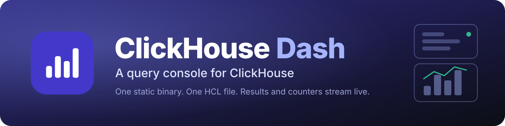
</p>

<p align="center">
  <a href="https://github.com/Circular-fi/Clickhouse-dash/actions/workflows/ci.yml"></a>
  <a href="https://github.com/Circular-fi/Clickhouse-dash/releases/latest"></a>
  <a href="#licence"></a>
  <a href="https://procurauth.github.io/procurauth/implementations.html"></a>
  
  
</p>

<p align="center">
  <a href="https://circular-fi.github.io/Clickhouse-dash/"><b>Website</b></a> ·
  <a href="#documentation">Docs</a> ·
  <a href="https://circular-fi.github.io/Clickhouse-dash/documentation.html#/access">Access</a> ·
  <a href="https://circular-fi.github.io/Clickhouse-dash/documentation.html#/configuration">Configuration</a> ·
  <a href="SECURITY.md">Security</a> ·
  <a href="https://github.com/Circular-fi/Clickhouse-dash/releases/latest">Downloads</a>
</p>

# ClickHouse Dash

ClickHouse Dash is a web console for ClickHouse. It runs SQL and streams the rows and the live counters of each query to the browser. It also shows the tables, the health of a server, and OpenTelemetry traces, logs and metrics. A built-in MCP server lets AI agents read the data.

It is for teams that run ClickHouse and want one small server for their queries, their tables and the health of their servers. It has one binary and one configuration file. **The SQL of a person runs only with the ClickHouse account of the host (`runner_uri`), so ClickHouse stays the boundary of the data.**

> **Source and mirror.** The source of this program is [`Circular-fi/Clickhouse-dash`](https://github.com/Circular-fi/Clickhouse-dash). The repository [`ProcurAuth/clickhouse-dash`](https://github.com/ProcurAuth/clickhouse-dash) is a read-only copy of its branch `main` and of its releases. See [Source and mirror](#source-and-mirror).

<p align="center">
  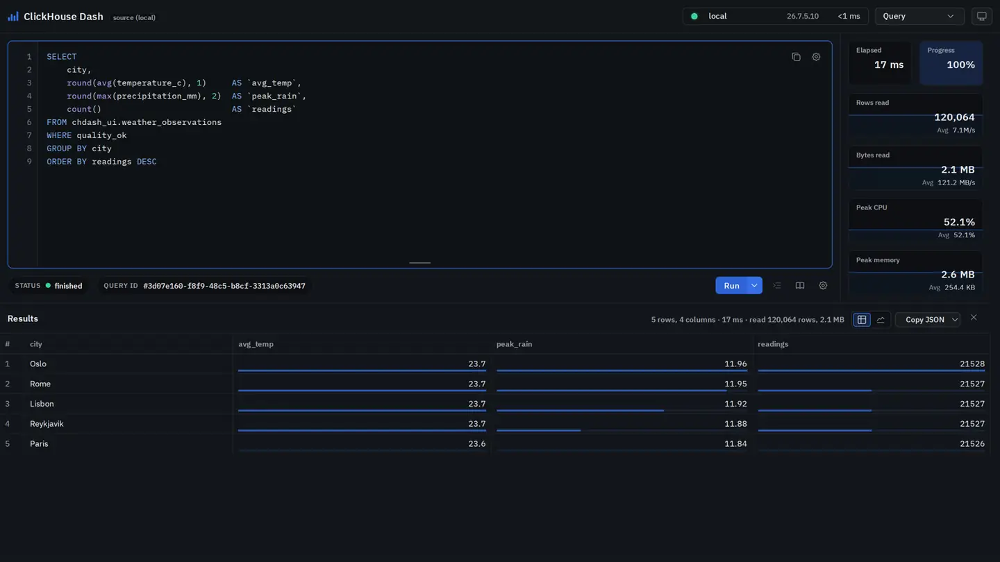
</p>

## How it works

ClickHouse Dash is one binary with the pages inside. The browser starts a query with one request, then reads the rows and the counters from a stream of Server-Sent Events. The backend speaks the native TCP protocol of ClickHouse. In the mode `authzen`, an edge signs an identity token, and ClickHouse Dash asks a decision point (PDP) before each action.

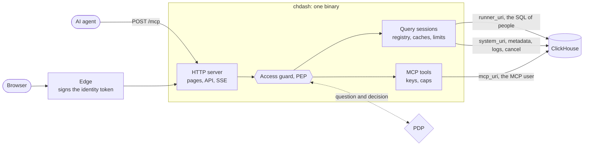

Each host has two URIs at least. The account of `runner_uri` runs the SQL of the people. The account of `system_uri` reads the metadata and the system logs, and it cancels a query. The query starts only when the browser opens the stream:

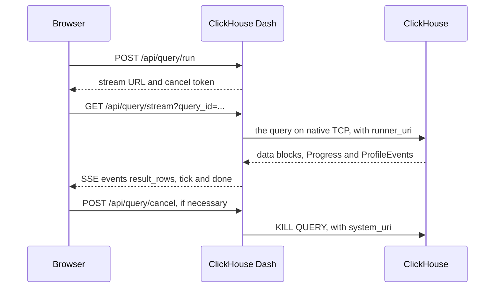

| Area | What ClickHouse Dash does |
| --- | --- |
| Query | Streamed result batches, live counters (elapsed time, read progress, rates, CPU and memory), cancel, several hosts, the SQL formatter, autocomplete, the history and saved queries. |
| Analysis | `Run with profiling` records the processor logs of one run. `Analyze` reads the logs that ClickHouse keeps, and never runs the query again. |
| Explorer | The catalog, the detail of a table, a preview of its data, the functions and a graph of the topology. The grants of the runner filter each answer. |
| System | The health of a server: tiles, topology, Keeper, replication, ten performance charts, the queues, the top query shapes and the disks. |
| Observability | Traces, logs and metrics from the tables of the OpenTelemetry Collector exporter for ClickHouse. |
| MCP | An optional MCP server (`POST /mcp`) for AI agents. It has its own ClickHouse user, keys, and caps on rows, bytes and time. |
| Exports | The download of the rows of a page, and an API that streams a ZIP64 archive directly from ClickHouse, with bounded memory. |
| Access | The mode `authzen` checks an identity token and asks a PDP. The mode `open` checks nothing, for a closed network only. |
| Configuration | One HCL file. A closed schema. A mistake stops the start. `--print-config` shows each value and its source. |
| Runtime | C++17 with clickhouse-cpp, cpp-httplib and RapidJSON. Plain JavaScript and Canvas, with WebAssembly kernels. Bounded caches. |

[docs/overview.md](docs/overview.md) gives the full list of features.

## Example

In the mode `authzen`, ClickHouse Dash is a PEP of [ProcurAuth](https://github.com/ProcurAuth/procurauth). The resource tree is service, host and database. A grant on a host covers each database of that host.

This `access` block makes ClickHouse Dash check the tokens of an edge and ask a PDP:

```hcl
access {
  mode = "authzen"

  identity {
    issuer           = "https://edge.example.com"
    audience         = "db"
    public_keys_file = "/etc/chdash/edge-keys.pem"
  }

  pdp {
    url        = "https://pdp.example.com:4182"
    token_file = "/etc/chdash/pdp-token"
  }
}
```

Alice runs `SELECT count() FROM analytics.events` on the host `prod`. ClickHouse Dash checks her token and finds a read. It asks the PDP for one use of `query.run.read` on the host:

```json
{ "subject":  { "type": "user", "id": "alice" },
  "action":   { "name": "query.run.read" },
  "resource": { "type": "host", "id": "prod",
                "properties": { "ancestors": [ { "type": "service", "id": "db" } ] } },
  "context":  { "usage": { "units": 1 } } }
```

The PDP answers `{"decision": true, "context": {"limits": {"max_rows": 1000}, "usage": {"units": 1}}}`. ClickHouse Dash then asks `query.run.write`, with no use. Alice does not hold it, so each statement runs with `readonly = 1`. The ceiling `max_rows` becomes the ClickHouse setting `max_result_rows`, and a larger result fails.

An answer of `false` gives `403`. A spent budget gives `429` with `Retry-After`. A PDP that does not answer gives `503`, never a grant. [docs/access.md](docs/access.md) has the rules.

## See it

<p align="center">
  <video src="docs/media/chdash-presentation-1080.mp4" poster="docs/assets/img/poster-1280.webp" width="100%" controls playsinline preload="none">
    <a href="docs/media/chdash-presentation.mp4">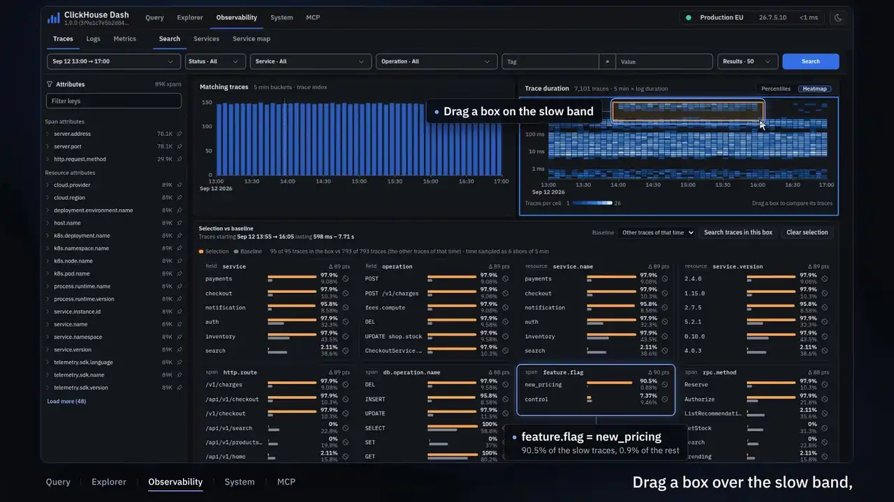</a>
  </video>
</p>

The video presents ClickHouse Dash with sample data, a voice-over and music. It lasts 74 seconds. If your viewer does not play the video, [open the video](docs/media/chdash-presentation.mp4). The original encode is 14 MB. The player above plays a lighter full HD copy.

The music is "Happy Beats & Business Moves Vol. 12" by Sascha Ende ([ende.app](https://ende.app)). The licence is [CC BY 4.0](https://creativecommons.org/licenses/by/4.0/). Use the sources in [docs/media/source](docs/media/source/README.md) to record and render the video again.

| | |
| --- | --- |
| [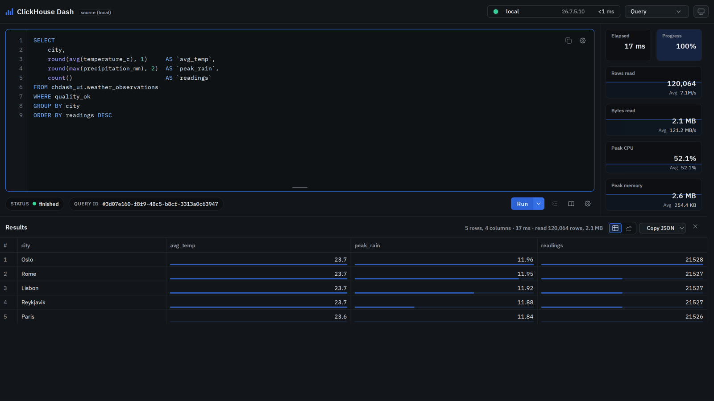](docs/media/screen-query.jpg) | [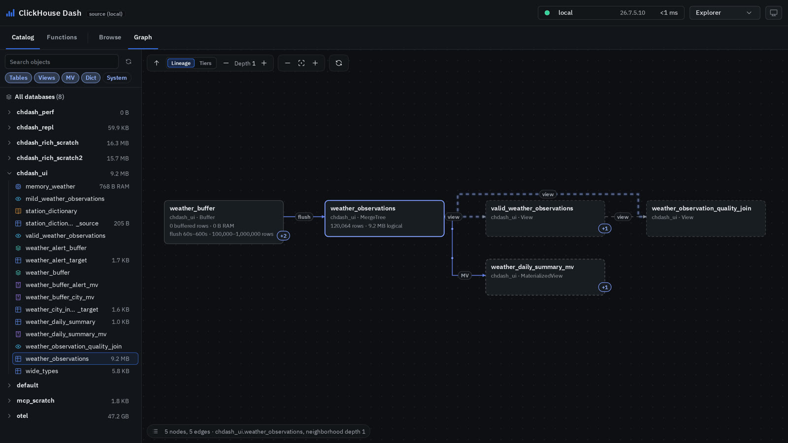](docs/media/screen-explorer.jpg) |
| The Query page, with the results of a query. | The Explorer graph of the tables and the views. |
| [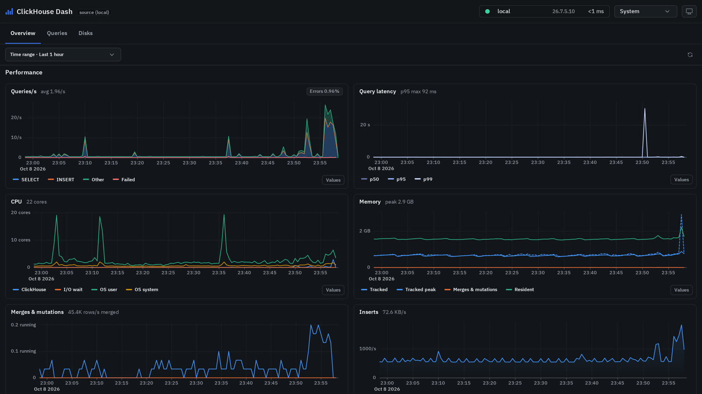](docs/media/screen-system.jpg) | [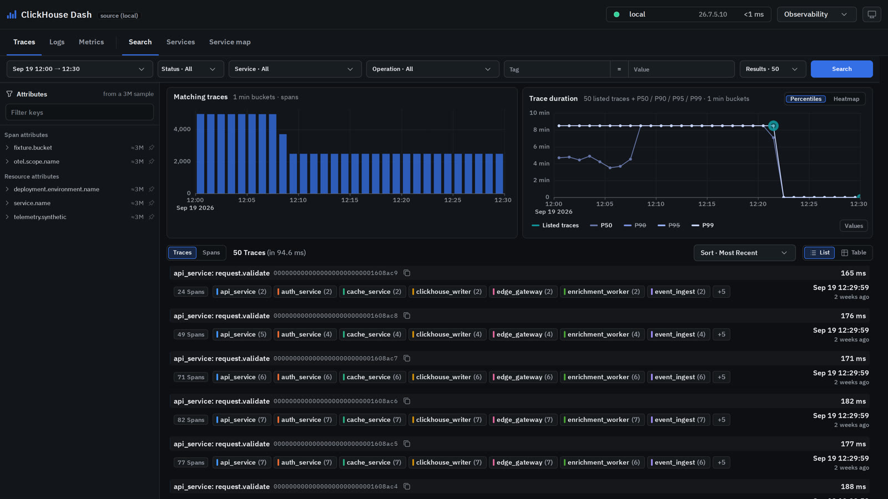](docs/media/screen-traces.jpg) |
| The performance charts of the System page. | The trace search of the Observability pages. |
| [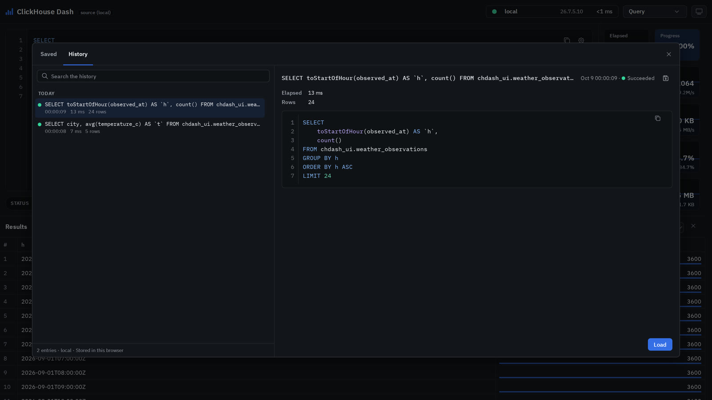](docs/media/screen-history.jpg) | [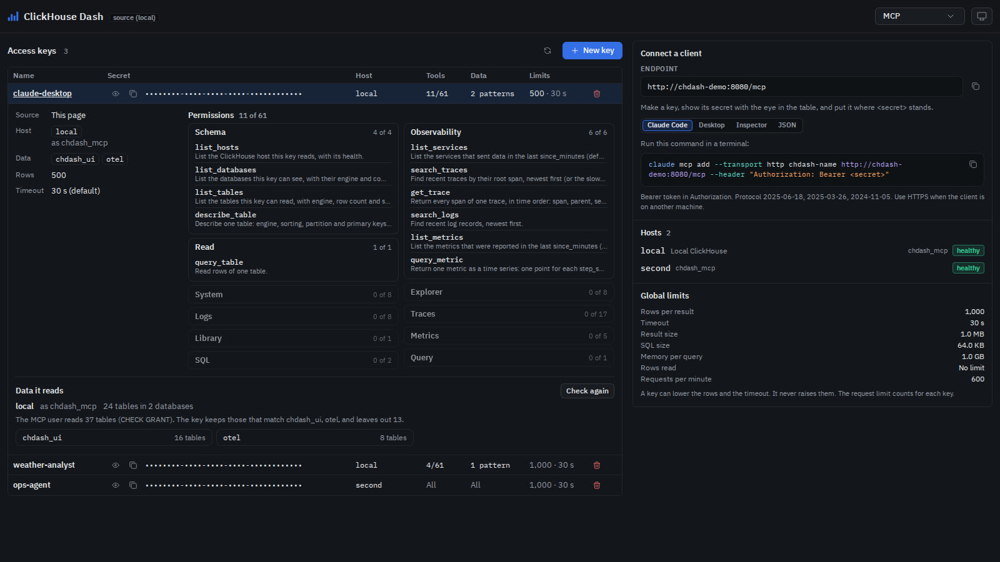](docs/media/screen-mcp.jpg) |
| The history and the saved queries of the query library. | The access keys of the MCP integration page. |

The [website](https://circular-fi.github.io/Clickhouse-dash/) shows the same pages and the video.

## Quick start

This test takes five minutes on Linux. It starts a local ClickHouse in Docker, bound to `127.0.0.1`. It pushes no image.

```sh
docker run -d --rm --name chdash-demo-ch -p 127.0.0.1:9000:9000 \
  -e CLICKHOUSE_USER=demo -e CLICKHOUSE_PASSWORD=demo-password clickhouse:26.7.5.10
```

Download ClickHouse Dash, check the archive, and write the configuration. For arm64, use the archive `chdash_1.6.0_linux_arm64.tar.gz`. Each release also has archives for macOS.

```sh
curl -fsSLO https://github.com/Circular-fi/Clickhouse-dash/releases/download/v1.6.0/chdash_1.6.0_linux_amd64.tar.gz
curl -fsSLO https://github.com/Circular-fi/Clickhouse-dash/releases/download/v1.6.0/SHA256SUMS
sha256sum --check --ignore-missing SHA256SUMS
tar -xzf chdash_1.6.0_linux_amd64.tar.gz
cat > config.hcl <<'EOF'
server { listen_host = "127.0.0.1" }
access { mode = "open" }
clickhouse {
  host {
    name         = "local"
    runner_uri   = "clickhouse://demo@127.0.0.1:9000"
    system_uri   = "clickhouse://demo@127.0.0.1:9000"
    password_env = "CHDASH_DEMO_PASSWORD"
  }
}
EOF
export CHDASH_DEMO_PASSWORD=demo-password
./chdash --config config.hcl --print-config
./chdash --config config.hcl
```

`--print-config` prints the value of each key and its source, then exits. Open `http://127.0.0.1:8080/` and run `SELECT version()`. Press Ctrl+C to stop ClickHouse Dash, then run `docker stop chdash-demo-ch`.

The password is a public demo value. The mode `open` checks nothing, so use it only on a closed network. In production, give `runner_uri` and `system_uri` two different accounts ([configuration](docs/configuration.md#recommended-clickhouse-account-separation)). [SECURITY.md](SECURITY.md#verify-a-release) tells how to verify the attestation of an archive.

## The ProcurAuth family

ClickHouse Dash follows the open specification of the [ProcurAuth](https://github.com/ProcurAuth) organisation, but its source is not in that organisation. The [implementations page](https://procurauth.github.io/procurauth/implementations.html) lists the programs, with the results of the conformance runs. [docs/conformance.md](docs/conformance.md) gives the run of ClickHouse Dash.

<p align="center">
  
</p>

| Part | Role | Repository | Site |
| --- | --- | --- | --- |
| **procurauth** | The specification and the reference tools | [ProcurAuth/procurauth](https://github.com/ProcurAuth/procurauth) | [procurauth.github.io/procurauth](https://procurauth.github.io/procurauth/) |
| **portal** | Backend, edge and PDP | [ProcurAuth/portal](https://github.com/ProcurAuth/portal) | [procurauth.github.io/portal](https://procurauth.github.io/portal/) |
| **Stowr** | PEP: a browser for S3, Google Cloud Storage and folders | [ProcurAuth/stowr](https://github.com/ProcurAuth/stowr) | [procurauth.github.io/stowr](https://procurauth.github.io/stowr/) |
| **Hune** | PEP: dashboards over ClickHouse, PostgreSQL and MongoDB | [ProcurAuth/hune](https://github.com/ProcurAuth/hune) | [procurauth.github.io/hune](https://procurauth.github.io/hune/) |
| **ClickHouse Dash** | PEP and MCP server: a query console for ClickHouse | [Circular-fi/Clickhouse-dash](https://github.com/Circular-fi/Clickhouse-dash) | [circular-fi.github.io/Clickhouse-dash](https://circular-fi.github.io/Clickhouse-dash/) |

To add a program to this list, open an issue in the [specification repository](https://github.com/ProcurAuth/procurauth/issues).

## Source and mirror

The repository `Circular-fi/Clickhouse-dash` is the source. Each change starts there. The issues and the pull requests are there too.

The repository `ProcurAuth/clickhouse-dash` is a mirror. It holds the branch `main`, with the same commits as the source, and a copy of each release. It has no other branch, no issue and no pull request. Nobody pushes to it: a rule of the repository refuses each push, except the push of the workflow `mirror` of the source.

- The workflow `mirror` runs on each push to `main` in the source, and when a release ends. It pushes the same commit to the mirror. It copies each release that the mirror does not have yet: the title, the notes and the files.
- If the two branches differ, the push fails and the mirror stays as it is. The run of the workflow `mirror` in the source shows the failure.
- A release of the mirror does not have the attestation of the build. Check an archive against the source: `gh attestation verify ARCHIVE --repo Circular-fi/Clickhouse-dash`.
- To report a problem or to send a change, use the source.

## Documentation

| Page | Content |
| --- | --- |
| [Overview](docs/overview.md) | The stack, the path of a query and the full list of features. |
| [Configuration](docs/configuration.md) and [keys](docs/configuration-reference.md) | The HCL file, the blocks, the two accounts of a host and the secrets. The list of keys comes from the code. |
| [Access](docs/access.md) and [conformance](docs/conformance.md) | The identity token, the PDP, the resources, the ceilings, the budgets, and the test of ProcurAuth. |
| [Operations](docs/operations.md) | The probes, the stop, the errors, the logs, the metrics and the HTTP security. |
| [HTTP API](docs/http-api.md) | Each route of the API. |
| [Profiles and analysis](docs/query-analysis.md) | `Run with profiling`, `Analyze`, the query registry and Deep Analyze. |
| [Query library](docs/query-library.md) and [SQL formatter](docs/formatter.md) | The history, the saved queries and the formatter. |
| [Exports](docs/massive-export.md) and [downloads](docs/post-run-download.md) | The ZIP64 stream exports, the downloads of a run and the debug archive. |
| [Explorer](docs/explorer.md) and [System](docs/system.md) | The catalog, the tables and the graph. The health of a server. |
| [Traces](docs/traces.md), [logs](docs/logs.md) and [metrics](docs/metrics.md) | The OpenTelemetry pages, and the projection indexes for large trace tables. |
| [MCP](docs/mcp.md) and [MCP page](docs/mcp-integration-page.md) | The MCP server, its keys, its tools, its ClickHouse user, and the page of the keys. |
| [Server telemetry](docs/server-telemetry.md) and [native TCP telemetry](docs/telemetry.md) | The OTLP export. The live counters, the SSE events and the JSON of the results. |
| [WebAssembly kernels](docs/wasm.md) and [UI foundations](docs/ui-foundations.md) | The kernels and their measures. The shared formats, colors and components of the pages. |
| [Tests](tests/README.md) | The Docker test stack, the test phases and the review archive. |
| [Release notes](docs/releases/) | The changes of each version. |

The same pages are on the [website](https://circular-fi.github.io/Clickhouse-dash/documentation.html). The Markdown files are the source.

## Build and test

The tests run in Docker. The host needs only Docker Compose.

```sh
cd tests
docker compose up -d --build                  # ClickHouse and a new build of the source, on http://localhost:18080
docker compose --profile test up -d --build   # the full suite in one container
```

The full suite writes one archive, `tests/artifacts/chdash-test-review.zip`. It takes more than one hour, so the workflow CI runs it on request. [`CONTRIBUTING.md`](CONTRIBUTING.md) tells how to build with CMake, and how to run the sanitizers, clang-tidy and the release smoke test.

## Security

Do not open a public issue for a vulnerability. [SECURITY.md](SECURITY.md) tells how to send a private report, the supported versions and the safe deployment. It also tells how to verify a release. The [security page](https://github.com/Circular-fi/Clickhouse-dash/security) of the source shows the policy.

## Contribute

Read [`CONTRIBUTING.md`](CONTRIBUTING.md). To report a defect or to ask for a feature, open an issue with one of the [forms](https://github.com/Circular-fi/Clickhouse-dash/issues/new/choose). [SUPPORT.md](SUPPORT.md) tells what to put in an issue. This project follows the [code of conduct](CODE_OF_CONDUCT.md).

## Licence

ClickHouse Dash is under the MIT licence. The file [`LICENSE`](LICENSE) holds the text. The fonts, the icons and the script of the website in [`docs/assets`](docs/assets) keep their own licences, in the files next to them.
